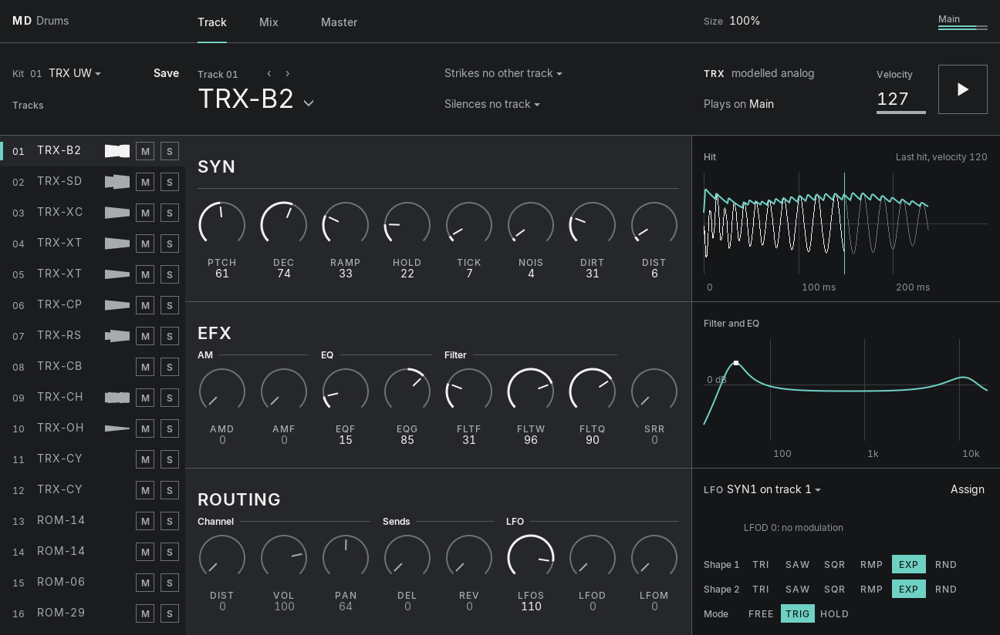
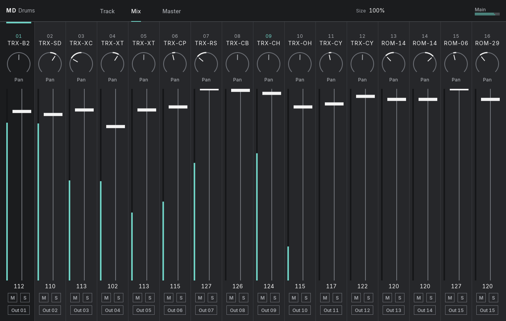
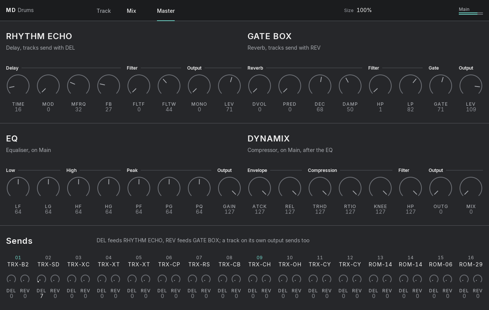

# MD Drums

The Elektron Machinedrum's own synthesis engines as a VST3 instrument, edited like Overbridge and played from your DAW.

**[Download the preview](https://github.com/c0remusic/gearmulator-md-drums/releases)** · [Report a bug](https://github.com/c0remusic/gearmulator-md-drums/issues)

MD Drums runs the code of the Machinedrum's OS 1.63 machines on emulated DSPs: the voice DSP for the 16 tracks, and
the mixer DSP for the master effects. The Machinedrum's OS and sequencer stay out, so it uses about a tenth of the CPU
of a full-machine emulation and loads in about a second. Your DAW plays the tracks with notes, and every parameter
can be automated.

## Features

- 16 tracks, with all the machines of OS 1.63. ROM machines play the UW sample bank of your flash image.
- An editor with Track, Mix and Master tabs, a machine browser with preview, and the Hit, Filter/EQ and LFO screens.
- The master effects run on the mixer DSP's own code: Rhythm Echo, Gate Box, EQ and Dynamix.
- A bank of 64 Kit slots, seeded with the 16 factory Kits, with `.syx` import and export. Links and Chokes too.
- Outputs: Main, plus Out 01 to Out 15. Any track can go to any Out.
- Locks: notes 64 to 87 set a parameter for a single hit.
- For Push 2, relay parameters that follow the track the editor shows ([setup](docs/md-drums-push2.md)).

| Mix | Master |
|---|---|
|  |  |

## You need

- Your own Machinedrum UW flash image with OS 1.63: the 8 MB file `elektron_sps1-1uw_os1.63.bin`, the same file
  Gearmulator MD uses. It is Elektron's copyright and is not included. MD Drums is for people who own the hardware, so
  please don't ask for the file.
- **Windows** x64 and a VST3 host. Tested in Ableton Live 12.
- **macOS**: a universal build (VST3 and AU), not tested yet.

The release's README says where to put the file and how to play.

## Status

This is a preview. RAM machines are silent for now. Live opens at most 16 output buses per plug-in, hence Main plus
15 Outs.

## Licence and credits

The combined work is distributed under the GNU AGPL v3 (see [NOTICE.md](NOTICE.md)). It is built from:

- [Gearmulator](https://github.com/dsp56300/gearmulator) by The Usual Suspects (GPL v3): the DSP56300 emulation and
  the plug-in framework ([upstream README](README.upstream.md));
- [Machinemodule](https://github.com/sd88me/mpc-vst-machinedrum) by sd88me (AGPL v3): the Machinedrum engine
  without its OS;
- [gearmulator-md-mm](https://github.com/c0remusic/gearmulator-md-mm), where the full-machine Machinedrum and
  Monomachine plug-ins live.

MD Drums is not affiliated with Elektron, nor with The Usual Suspects. "Elektron" and "Machinedrum" are trademarks of
Elektron Music Machines MAQ AB, used only to name the hardware.
